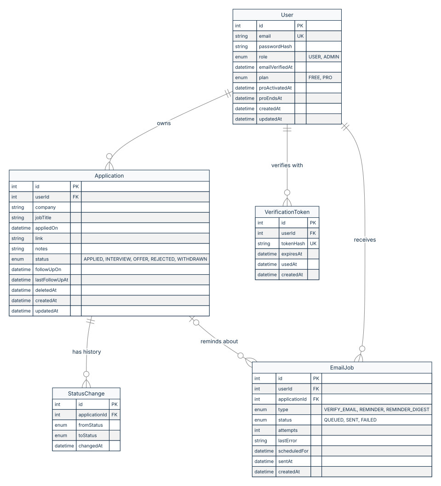

# Aplika: data model

The things Aplika stores, taken from the business rules and flows in [`rules-and-flows.md`](rules-and-flows.md). The models live in [`backend/prisma/schema.prisma`](../backend/prisma/schema.prisma) and the tables are created by the first migration in `backend/prisma/migrations/`.



## The five models

| Model | What it is | Main links |
|---|---|---|
| **User** | A job seeker or the admin. Holds the login, whether the email is verified, and the plan (Free or Pro). | Has many Applications, VerificationTokens and EmailJobs |
| **Application** | One job application: company, job title, date applied, optional link and notes, current status and the next follow-up date. | Belongs to one User; has many StatusChanges and EmailJobs |
| **StatusChange** | One move between stages, with the date, so the user sees the history of an application. | Belongs to one Application |
| **VerificationToken** | The secret link sent by email to verify an address. Only a hash is stored. | Belongs to one User |
| **EmailJob** | One email in the queue: a verification email, a reminder, or a daily digest. Tracks attempts and whether it was sent or failed. | Belongs to one User; optionally about one Application |

## How the business rules show up in the model

| Rule (from `rules-and-flows.md`) | Where it lives |
|---|---|
| 1. Verify email before adding applications | `User.emailVerifiedAt`, `VerificationToken` |
| 2. Each application belongs to exactly one user | `Application.userId` (required, cascades on user delete) |
| 3. Company, job title and date applied are required | `company`, `jobTitle`, `appliedOn` are not nullable; "not in the future" is checked in code |
| 4. Status is one of five values | `ApplicationStatus` enum |
| 5. Free plan: 25 active applications | `User.plan`; counted from `Application.status` in code |
| 6. Default follow-up 7 days after applying | `Application.followUpOn`, set in code |
| 7. No reminders for Offer, Rejected, Withdrawn | `followUpOn` cleared when status changes |
| 8. At most 1 reminder per application per day, 5 per user per day | `EmailJob.userId`, `applicationId`, `scheduledFor` (indexed) |
| 9. Deleted applications can be restored for 30 days | `Application.deletedAt` (soft delete) |
| 10. Failed email retried up to 3 times, then failed | `EmailJob.attempts`, `EmailJob.status` |
| 11. Duplicate warning (same company, title, date) | Index on `userId, company, jobTitle, appliedOn`; a warning, not a hard block |
| 12-13. Admin turns Pro on and off; data stays when Pro ends | `User.plan`, `proActivatedAt`, `proEndsAt`, `User.role` |

## Same model in DBML (for dbdiagram.io)

Paste this into [dbdiagram.io](https://dbdiagram.io) to see or export the diagram there.

```dbml
Enum Role { USER ADMIN }
Enum Plan { FREE PRO }
Enum ApplicationStatus { APPLIED INTERVIEW OFFER REJECTED WITHDRAWN }
Enum EmailType { VERIFY_EMAIL REMINDER REMINDER_DIGEST }
Enum EmailStatus { QUEUED SENT FAILED }

Table User {
  id int [pk, increment]
  email varchar [unique, not null]
  passwordHash varchar [not null]
  role Role [not null, default: 'USER']
  emailVerifiedAt datetime
  plan Plan [not null, default: 'FREE']
  proActivatedAt datetime
  proEndsAt datetime
  createdAt datetime [not null]
  updatedAt datetime [not null]
}

Table VerificationToken {
  id int [pk, increment]
  userId int [not null, ref: > User.id]
  tokenHash varchar [unique, not null]
  expiresAt datetime [not null]
  usedAt datetime
  createdAt datetime [not null]
}

Table Application {
  id int [pk, increment]
  userId int [not null, ref: > User.id]
  company varchar [not null]
  jobTitle varchar [not null]
  appliedOn datetime [not null]
  link varchar
  notes text
  status ApplicationStatus [not null, default: 'APPLIED']
  followUpOn datetime
  lastFollowUpAt datetime
  deletedAt datetime
  createdAt datetime [not null]
  updatedAt datetime [not null]
}

Table StatusChange {
  id int [pk, increment]
  applicationId int [not null, ref: > Application.id]
  fromStatus ApplicationStatus
  toStatus ApplicationStatus [not null]
  changedAt datetime [not null]
}

Table EmailJob {
  id int [pk, increment]
  userId int [not null, ref: > User.id]
  applicationId int [ref: > Application.id]
  type EmailType [not null]
  status EmailStatus [not null, default: 'QUEUED']
  attempts int [not null, default: 0]
  lastError text
  scheduledFor datetime [not null]
  sentAt datetime
  createdAt datetime [not null]
}
```

## Changing the model later

1. Edit `backend/prisma/schema.prisma`.
2. Run `npm run db:migrate:new -w backend -- --name what_changed` to create and apply a new migration.
3. Update this file and the diagram.
